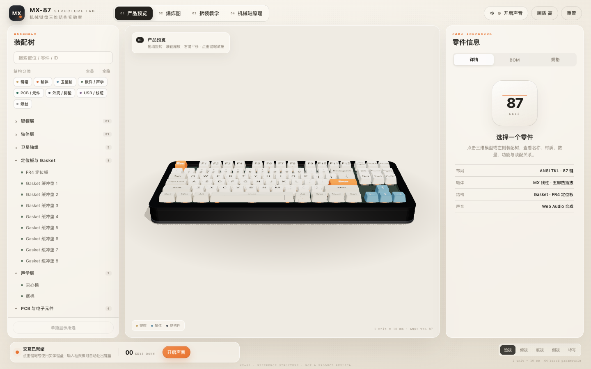
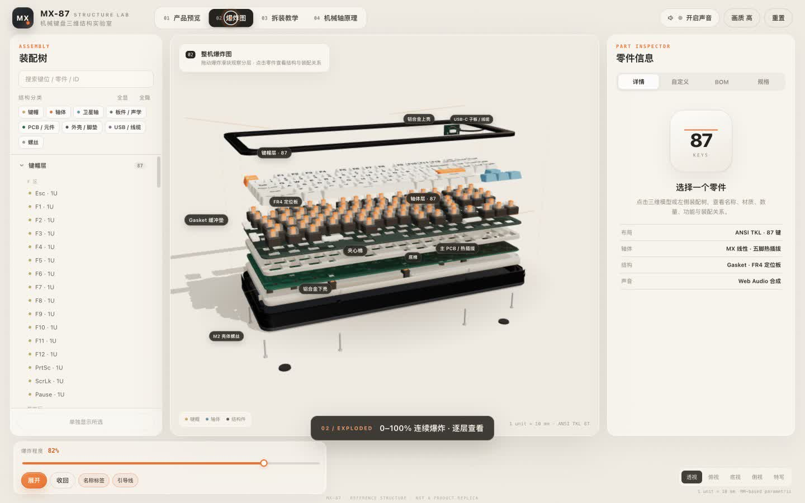
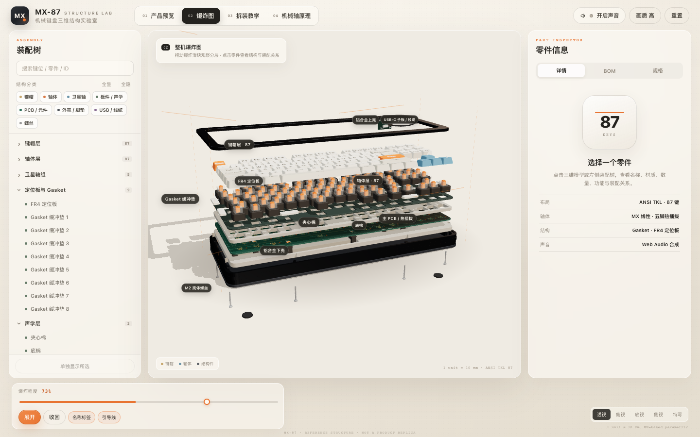
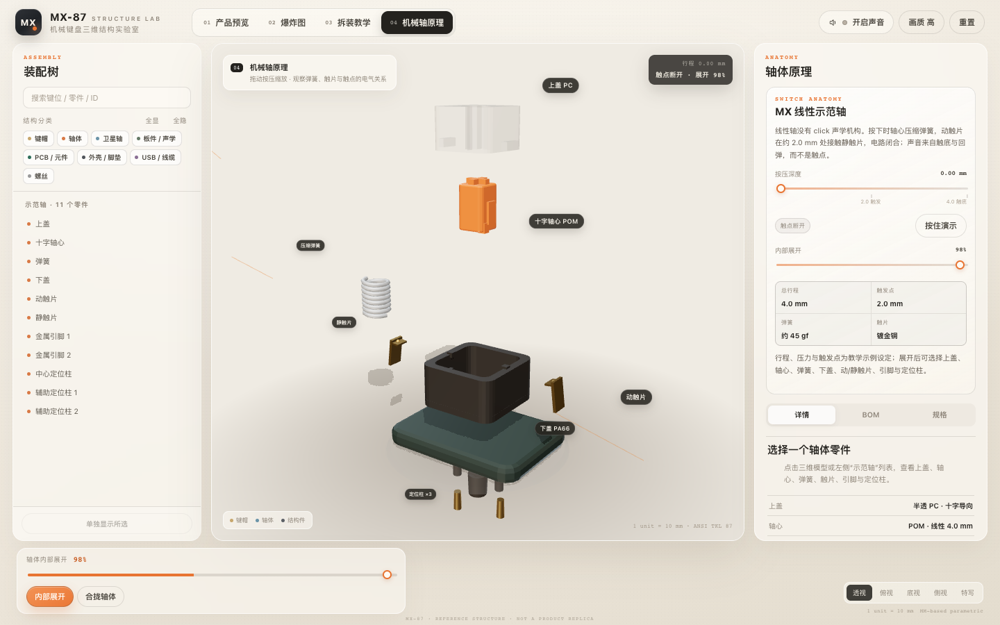
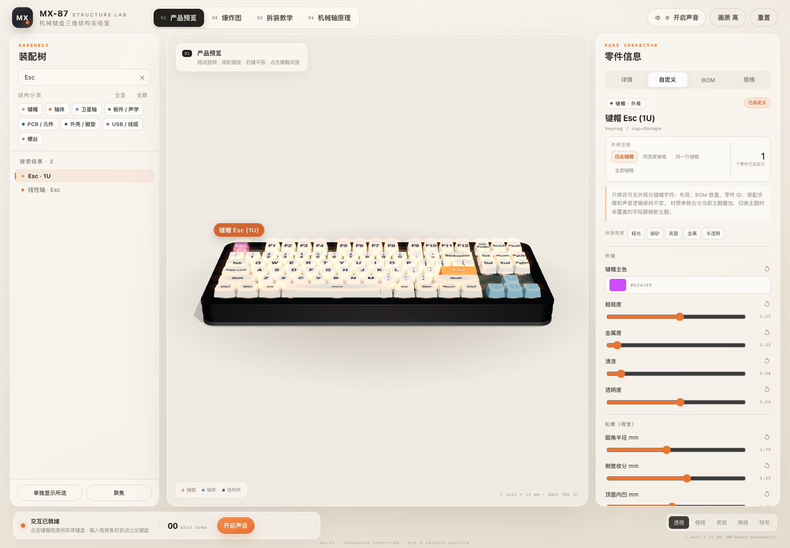
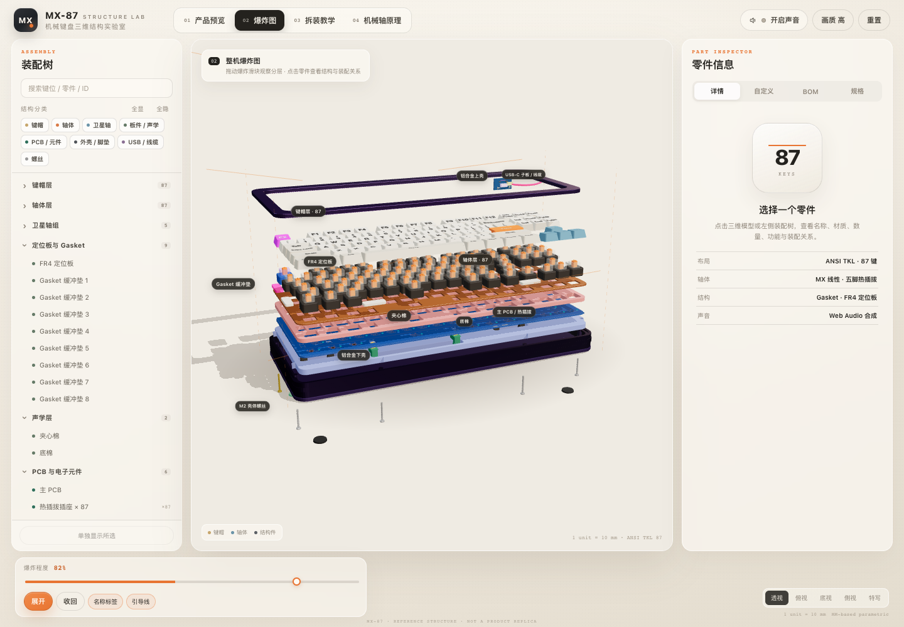
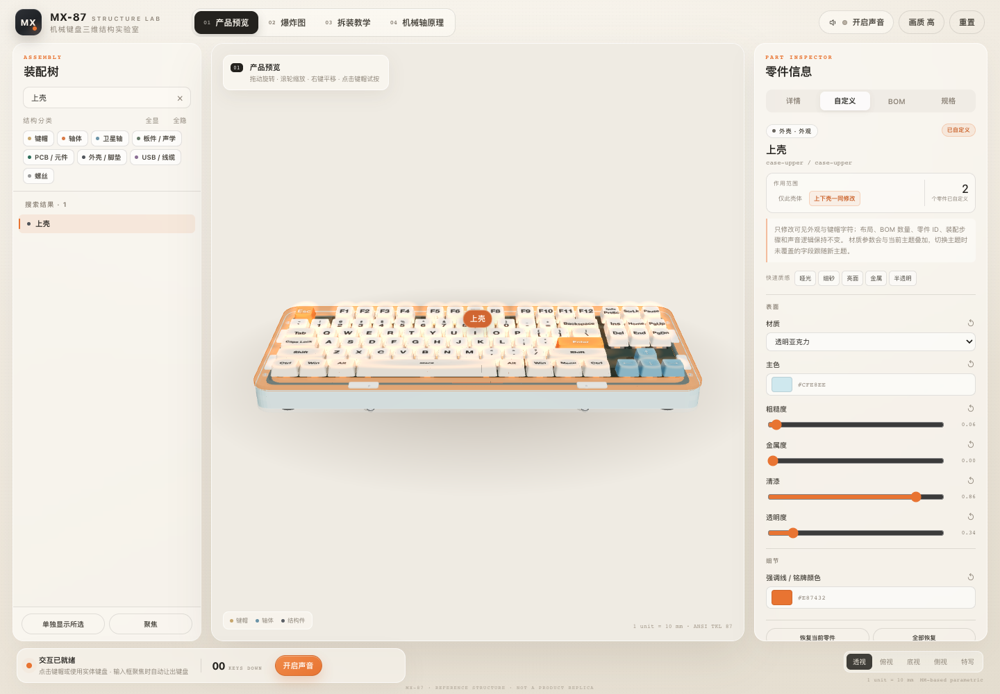
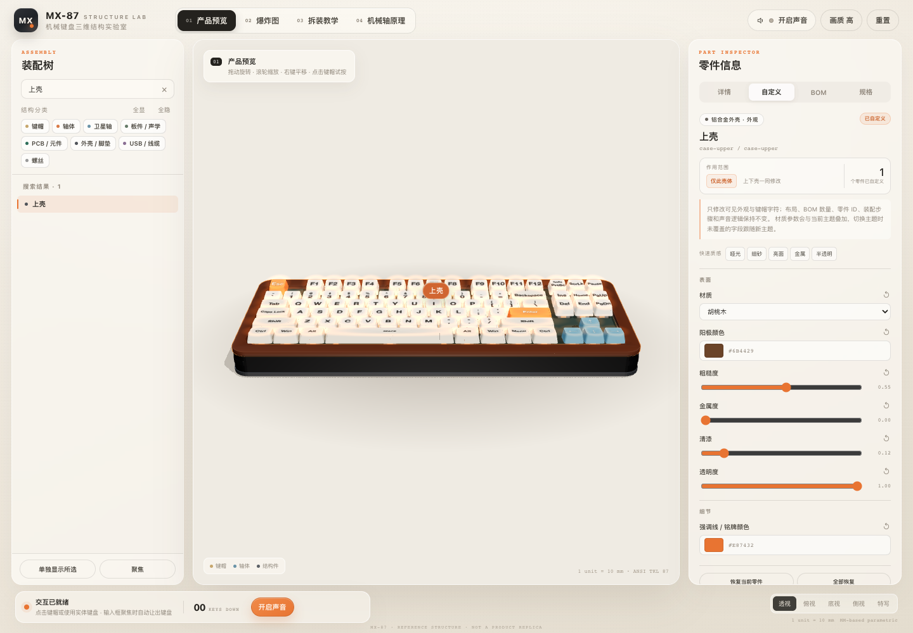
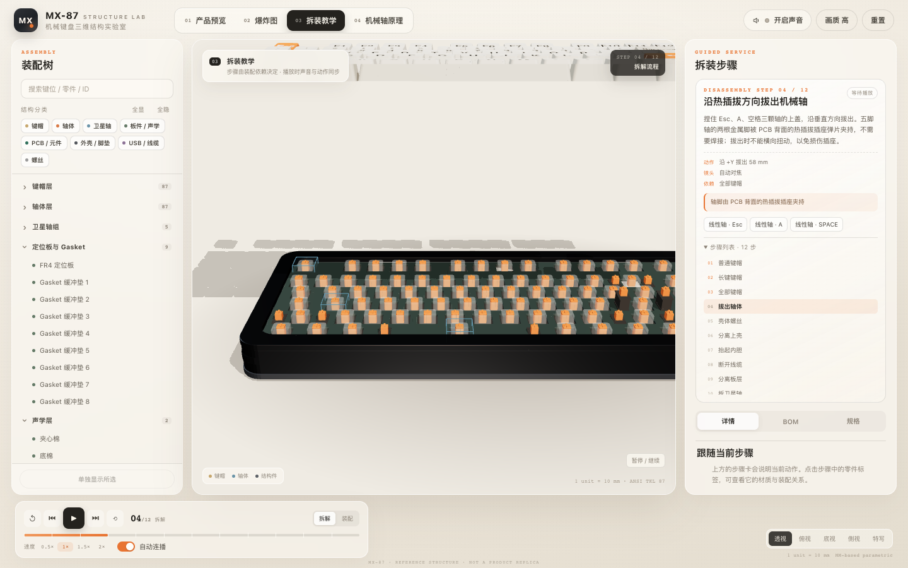
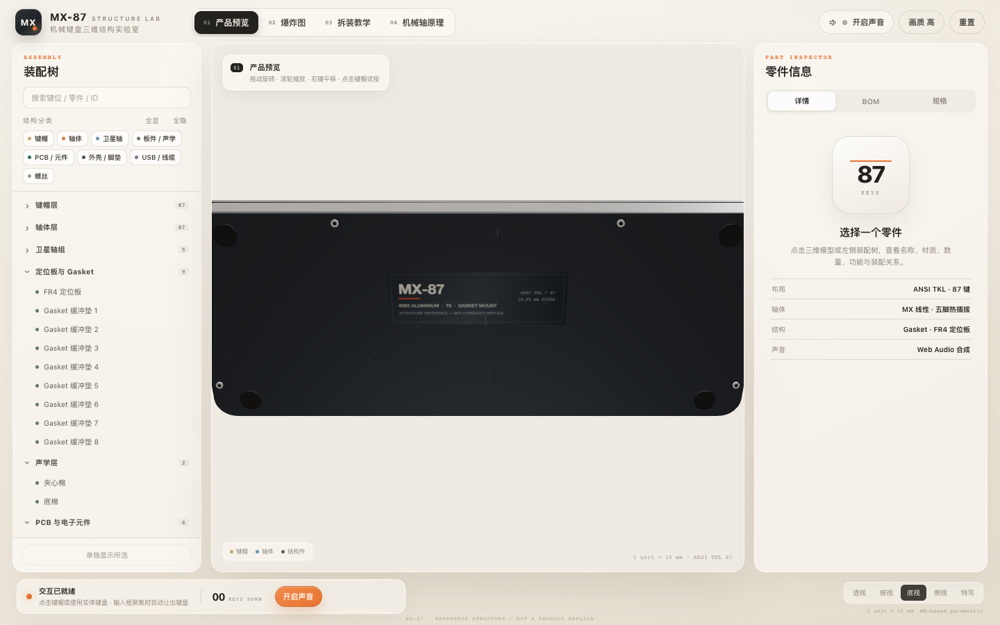

# MX-87 STRUCTURE LAB

**机械键盘三维结构与交互装配实验室**  
React + TypeScript + Vite + Three.js / React Three Fiber / drei + Zustand + Web Audio。

一把依据 ANSI 87 键 TKL 结构规格参数化生成的机械键盘：所有键位、板件、轴体、卫星轴、Gasket、外壳与拆装步骤都由代码生成。支持整机爆炸图、拆解 / 装配教学、示范轴内部剖析、实体键盘与鼠标联动、合成音效与中文讲解。

> 这是一把教学用参考键盘，不宣称精确复刻任何真实量产产品。

**在线演示：** https://book.fern-li.cn/keyboard-emulator/



## 介绍视频

[▶ 观看 80 秒中文字幕介绍视频](docs/mx87-intro.mp4)

[](docs/mx87-intro.mp4)

视频包含：产品预览、逐键按压、整机爆炸、12 步拆装教学、示范轴内部结构、胡桃木/亚克力外壳与 LED 灯效。**视频无音频，使用烧录中文字幕**；画面为浏览器实际操作录屏。

章节：`00:00` 开场 / `00:07` 预览 / `00:14` 爆炸 / `00:31` 教学 / `00:42` 轴体 / `00:50` 自定义 / `01:07` 结束

## 快速开始

要求 **Node.js ≥ 20.19**（Vite 7 的要求）。

```bash
npm install
npm run dev       # http://127.0.0.1:5173
npm run build     # TypeScript 检查 + 生产构建
npm run preview   # 预览构建产物
npm test          # 自动检查（布局 / 零件 / 步骤 / 复位 / 外观 / 材质）
```

首次进入后点击顶栏或底部「开启声音」并完成一次用户手势，Web Audio 才会启动。浏览器没有可用中文语音时，文字步骤和动作音效仍会正常运行。

## 部署到 GitHub Pages

仓库已经包含 [`.github/workflows/pages.yml`](.github/workflows/pages.yml)。Vite 使用相对 `base`，因此同一份构建既可以放在 `https://<user>.github.io/`，也可以放在项目路径 `https://<user>.github.io/<repo>/`。

1. 在 GitHub 创建仓库并推送 `main`：

```bash
git remote add origin https://github.com/<你的用户名>/<仓库名>.git
git push -u origin main
```

2. 打开仓库 **Settings → Pages**，把 **Build and deployment → Source** 设为 **GitHub Actions**。
   - 这一步必须由仓库管理员在网页端完成一次；`GITHUB_TOKEN` 没有开启 Pages 的管理员权限。
3. 工作流会自动执行 `npm ci`、`npm test`、`npm run build`，并把 `dist/` 发布为 Pages artifact。
4. 部署完成后访问 `https://<你的用户名>.github.io/<仓库名>/`；当前仓库的线上地址是 https://book.fern-li.cn/keyboard-emulator/。

也可以用 GitHub CLI 一次完成建库和推送（需要先 `gh auth login`）：

```bash
gh repo create <仓库名> --public --source=. --remote=origin --push
```

本地验证静态构建：

```bash
npm run build
npm run preview
```

`dist/` 中包含 `.nojekyll`，不会经过 Jekyll 处理；项目没有前端路由，因此不需要额外配置 404 回退。

## 四个模式

| 模式 | 内容 |
| --- | --- |
| 产品预览 | 装配完成的键盘，可旋转/缩放/平移，点击键帽或用实体键盘触发按压、回弹、灯光与声音。 |
| 爆炸图 | 0–100% 连续爆炸滑块、一键展开/收回、零件标签；以垂直分层为主，上壳、USB 子板、螺丝、脚垫做横向/轴向偏移。 |
| 拆装教学 | 12 个由装配依赖决定的步骤，支持拆解 / 装配双向、播放、暂停、上一步、下一步、重播、从头开始、跳转、0.5–2× 速度与自动连播。 |
| 机械轴原理 | 精细示范轴的装配/内部展开、按压深度、总行程 4.0 mm 与 2.0 mm 触发位置、弹簧压缩、动/静触片闭合与电路触发提示。 |

### 视觉记录

| 整机爆炸图 | 示范轴内部展开 |
| --- | --- |
|  |  |

| 键帽外观自定义 | 多部件自定义爆炸图 |
| --- | --- |
|  |  |

| 亚克力外壳 | 胡桃木外壳 |
| --- | --- |
|  |  |

| 拆装步骤与高亮 | 底部结构 |
| --- | --- |
|  |  |

## 外观自定义

右侧面板新增 **「自定义」** 标签。选中零件后，只显示该类型真正可见的外观参数；所有修改实时生效，并保存在浏览器 `localStorage` 中。

| 部件 | 可调外观与材质 |
| --- | --- |
| 键帽 | 材质：PBT / ABS / 树脂 / 陶瓷 / 铝合金 / 亚克力 / 胡桃木；主色、粗糙度、金属度、清漆、透明度；圆角半径、侧壁收分、顶面内凹；主/副字符文本、字符颜色、字号、字重、字体、字符微光 |
| 机械轴 | 下盖色、上盖色、轴心色；上盖透明度、上盖/轴心粗糙度（全部轴体） |
| 卫星轴 | 材质：PA66 / POM / 铝合金；外壳色、轴心色、钢丝颜色/金属度/粗糙度、螺丝颜色 |
| 定位板 | 材质：FR4 / 铝合金 / 黄铜 / 碳纤维 / POM / 亚克力；板面颜色、粗糙度、金属感、透明度 |
| 夹心棉 / 底棉 | 材质：聚氨酯 / 硅胶泡棉 / 毛毡；颜色、粗糙度、透明度、颗粒强度；可一键同步两块棉 |
| Gasket | 材质：硅胶 / 橡胶 / Poron；颜色、粗糙度、透明度；可一键同步 8 枚缓冲垫 |
| PCB | 基材：FR4 / 铝基板 / 陶瓷基板；阻焊色、丝印色、走线色、走线强度、走线/丝印显隐、粗糙度/金属感 |
| PCB 元件 / LED | 插座、二极管、主控、阻容颜色；LED 基础色、按压色、亮度、光晕半径与常亮/按压/呼吸/渐变模式 |
| 上壳 / 下壳 | 材质：6063 铝合金 / 胡桃木 / 桃花心木 / 透明亚克力 / 黄铜 / 不锈钢 / 碳纤维 / 聚碳酸酯；主色、粗糙度、金属度、清漆、透明度、强调线/铭牌颜色；可上下壳一同修改 |
| 螺丝 / 脚垫 | 材质：不锈钢 / 黑镍 / 黄铜 / 钛合金 / 紫铜；脚垫：丁腈橡胶 / 硅胶 / 毛毡 / 软木；可全部同步 |
| USB-C 子板 | 基材：FR4 / 铝基板 / 陶瓷基板；子板颜色、接口金属色、塑料座颜色、状态指示颜色与亮度 |
| 内部连接线 | 材质：橡胶 / 编织 / 伞绳；线材颜色、接头颜色、表面粗糙度 |
| 示范轴内部 | 材质：PC / 亚克力 / POM / 尼龙 / 铝合金 / 不锈钢 / 镀金 / 黄铜 / 银 / 铜；按上盖、轴心、弹簧、下盖、触片、引脚/定位柱分别调整 |

操作方式：

- 作用范围支持「仅此键帽 / 同宽度键帽 / 同一行 / 全部键帽」；轴体、卫星轴、Gasket、声学棉、螺丝、脚垫、上下壳也有对应的同类范围。
- 「快速质感」提供哑光、细砂、亮面、金属、半透明预设，只写入该类零件实际展示的字段。
- 支持恢复单个字段、恢复当前零件、全部恢复。
- 支持导出 / 导入 `mx87-appearance.json`，便于保存配色方案。
- 自定义只改变外观，不修改布局、BOM 数量、零件 ID、装配步骤、按键逻辑与声音事件。
- 半透明外壳侧壁使用无盖壳体、透明材质和可选内衬：默认「透明时遮挡内部」开启，避免内部层叠被误认为条纹；关闭后可观察内部结构。

## 操作

- **旋转 / 缩放 / 平移**：OrbitControls，左键拖动、滚轮、右键平移。
- **视角**：底部「透视 / 俯视 / 底视 / 侧视 / 特写」。爆炸图、教学步骤和轴体模式会自动调整构图。
- **键帽**：点击触发一次按压/回弹；实体键盘使用 `KeyboardEvent.code` 映射。
- **输入框聚焦时**不接管键盘；点击 UI 按钮后实体键盘仍可使用，并自动移除按钮焦点。
- **窗口失焦**会释放所有按键，避免卡键；自动重复事件被忽略。
- **装配树**：搜索、分类折叠、87 个键帽与 87 个轴体的独立条目、分类显隐、单独显示、恢复全部、双击聚焦。
- **详情 / BOM / 规格**：三者共享同一套零件 ID；规格页可切换三套材质配色（石墨 / 午夜 / 暖沙）。
- **画质**：顶栏「画质 高 / 流畅」切换阴影、Environment、阴影贴图与 DPR。

## 三维结构

所有尺寸以毫米编写，模型整体包在 `scale = 0.1` 的组中，即 **1 Three.js 场景单位 = 10 mm**。键位间距 19.05 mm。

| 项目 | 规格 |
| --- | --- |
| 布局 | ANSI TKL 87 键，18.25U × 6.5U 键区 |
| 外壳 | 372 × 152 mm，3.2 mm 壁厚，6063 铝合金，圆角 14 mm |
| 定位板 | 356 × 132 × 1.4 mm FR4，87 个 14.15 mm 轴孔 + 10 个卫星轴避让孔 |
| PCB | 354 × 130 × 1.6 mm，87 组热插拔轴位、LED、二极管与主控；真实孔位与轴脚对应 |
| 夹心棉 | 位于定位板与 PCB 之间，按轴体、卫星轴和主控开孔 |
| 底棉 | 底壳内腔，避让螺柱、卫星轴钢丝与线缆通道 |
| Gasket | 8 枚硅胶缓冲垫，坐在下壳台阶上，由顶壳压住约 0.2 mm |
| 卫星轴 | 5 组 PCB 螺丝固定式，Space 100 mm、Enter 30 mm、Backspace 25 mm、左右 Shift 30/35 mm 跨距 |
| USB | 独立 USB-C 子板 + 2 颗固定螺丝 + 4 pin 内部连接线（TubeGeometry 曲线） |
| 螺丝 | 6 颗 M2 × 24 mm 壳体螺丝，从底壳旋入上壳 |
| 脚垫 | 4 枚丁腈橡胶脚垫 |

### 装配树

`asm-keycaps / asm-switches / asm-stabs / asm-plate / asm-foam / asm-pcb / asm-case` 七个装配组，共 200+ 个可寻址零件。键帽与轴体各有 87 个独立 ID（`cap-*`、`sw-*`），BOM、拾取、标签、选择、教学动画全部复用同一套 ID。

### 爆炸分层

整机爆炸以 Y 轴为主：

```
脚垫 → 螺丝 → 下壳 → 底棉 → PCB/热插拔/卫星轴
→ 夹心棉 → 定位板 → Gasket → 轴体层 → 键帽层 → 上壳
```

USB 子板/线缆在拆开后从后方取出；爆炸图中被暂存到右上方并单独标注。上壳、子板、螺丝采用横向/轴向偏移，避免各层完全互相遮挡。

## 核心实现

### 数据驱动

- `src/data/layout.ts`：`KeyDefinition[]`（87 键、ANSI 位置、1U 基准宽度、分行高度与倾角、卫星轴跨距、物理键码）。
- `src/data/parts.ts`：`PartDefinition[]`（id、类型、材质、父级、装配变换、爆炸变换、说明、数量、子零件）。
- `src/data/steps.ts`：`AssemblyStep[]`（依赖、参与零件、位移/旋转、镜头、说明、声音事件、旁白）。
- `src/state/director.ts`：装配位置是唯一数据源；每帧只根据 `assembly + 当前爆炸/教学偏移 + 按压深度` 重算变换。

### 无累积误差

教学状态只保留 `completedThrough / activeStep / progress / motion`，不递增修改对象位置。任意跳转、暂停、重播都会从步骤数据重建状态；压缩后的复位测试验证同一跳转重复执行得到相同位置，`restart()` 回到精确装配位置。

爆炸滑块与教学状态互不影响：切出教学时爆炸目标归零，切回教学时步骤状态被保留。

### 实例化与缓存

- 87 颗轴体的下盖、上盖、轴心使用 InstancedMesh，逐帧更新实例矩阵。
- 87 颗键帽共享按（宽度、行高、卫星轴跨距）缓存的几何，字符为逐键 CanvasTexture。
- 87 颗 LED 使用 InstancedMesh + 实例颜色；按压时对应 LED 增亮。
- 键帽顶部光晕与底部光环使用两个 87 实例的加色混合平面，按压时出现可见灯光反馈。
- 板件开孔在初始化时用 `ExtrudeGeometry + Shape holes` 生成并缓存，不在每帧做 CSG。
- PCB 走线/丝印是程序绘制的 CanvasTexture，不依赖远程资源。

### 键盘与鼠标联动

- 实体键盘优先使用 `KeyboardEvent.code`，正确处理多键、自动重复、窗口失焦。
- 鼠标点击使用一次按下 + 0.14 s 后自动回弹。
- 长键（Space / Enter / Backspace / Shift）的按键物理更重，并联动卫星轴轴心与钢丝。
- 按压弹簧使用固定 120 Hz 子步积分，避免低帧率下数值爆炸；弹簧参数与行程是示例设定。

### 声音

- 全部由 Web Audio API 实时合成：噪声 + 带通滤波 + 正弦/三角波包络；包括普通键、长键、拔键帽、拔/插轴、螺丝旋入、金属/塑料轻触、子板插拔、弹簧、完成提示。
- 总线：按键 / 装配 / 界面分类增益 → 主音量 → 压缩器 → 输出；并发声部上限 16，避免削波。
- 时间线声音由 `AssemblyStep.sound` 语义事件驱动，按动画进度穿越触发，不使用 `setTimeout`；暂停/跳转/重播/模式退出会取消待播音源与已排队事件。
- 随机音量、音高、滤波器频率减少重复感。
- SpeechSynthesis 检测中文语音；可用时播放步骤旁白，不可用时保留文字与动作音效。语音与音效独立开关。
- 声音入口、主音量与分类音量、静音、音效/讲解开关在顶栏声音弹出层。

## 验证记录

以下均为实际执行过的检查，不是占位声明：

```text
npm test
  tests/data.test.ts  23 tests passed
  - 87 键、唯一 ID/键码/switchId
  - ESC/F1–F12/导航/方向键/长键宽度
  - 键帽位于键区/外壳内
  - 5 组长键卫星轴
  - 零件唯一 ID、父级、材质
  - 板层爆炸顺序
  - 87 keycap + 87 switch 一一对应
  - 示范轴 11 个内部零件
  - 无 battery/wireless/tray 零件
  - 步骤依赖、引用 ID、声音时间合法
  - 重复跳转位置一致、restart 精确复位、拆/装跳转状态确定
  - 离开教学模式时暂停时间线，避免旧动画/声音继续
  - 每类零件均有可见外观 schema；作用范围映射到稳定 ID
  - 默认外观解析、单件覆盖、导入 JSON 键名/类型过滤
  - 材质家族、variants 归一化、透明内衬默认值
```

```text
npm run build
  tsc -b 通过
  vite build 通过（three / r3f / app 代码分块）
```

浏览器实测（Playwright + 系统 Chrome + SwiftShader，1440×900 / 820×1180 / 430×880）：

- 四个模式可切换，控制台无 pageerror / console error。
- 爆炸滑块连续变化；一键展开/收回；标签显隐开关。
- 点击键帽打开详情、装配树选中同步；单独显示只保留所选零件。
- 实体键盘在点击 UI 按钮后仍可触发；搜索框聚焦时让出键盘；Space 长键按压与回弹；窗口 blur 释放全部键。
- 教学播放、暂停、步骤跳转、装配方向、步骤列表、速度与自动连播可操作；示范轴展开后 11 个零件可拾取。
- 声音入口可让 AudioContext 进入 running；按键和步骤时间线实际创建了 oscillator/buffer 节点；步骤旁白实际调用 SpeechSynthesis（测试环境记录到了中文文本）。
- WebGL 不可用时显示独立降级页；加载层在首帧后隐藏，并有 15 s 兜底。
- 平板/手机侧栏变为抽屉，可开合；手机底部视口按钮、声音入口可用。
- 三套配色切换、画质切换、BOM / 规格面板渲染正常。
- 自定义：键帽颜色、透明度、字符、圆角，以及 PBT / ABS / 树脂 / 陶瓷 / 铝合金 / 亚克力 / 胡桃木材质实测；轴体、卫星轴、Gasket、定位板、声学棉、PCB、LED、上下壳、螺丝、脚垫、USB、连接线、示范轴外观均实测修改；胡桃木、亚克力、碳纤维、毛毡、编织等程序纹理材质已接入；localStorage 刷新持久化、导出/导入、恢复单项/全部、主题切换保留覆盖均验证通过。
- 透明外壳：外壳侧壁改为无盖壳体并关闭透明态阴影；下壳默认使用内衬遮挡内部层叠，可在「透明时遮挡内部」中关闭查看内部。

限制说明：

- 以上声音验证确认了 **Web Audio 图实际被创建**，但无头浏览器没有物理扬声器，无法证明实际可听见的响度；真实设备上仍建议手动听测。
- 无头 SwiftShader 帧率较低，部分长步骤在测试中只播放到前段；使用固定步长与单元测试验证了状态和复位一致性。
- 未在 Windows / Safari / Firefox 上逐项实测，代码使用标准 WebGL / Web Audio / SpeechSynthesis API。

## 教学化简化与已知限制

- 自定义聚焦于可见外观；不开放板厚、壳体壁厚、键位间距、螺丝长度、开孔位置等结构尺寸，避免破坏装配关系。
- 内部高度、间隙、螺丝长度由结构关系推导，不是真实产品的工程图或可直接生产的 CAD。
- PCB 走线、焊盘、丝印是结构性示意纹理，**不是 Gerber 文件**。
- 弹簧压力、2.0 mm 触发、4.0 mm 总行程是示例设定；线性轴没有以 click 发声的机构。
- 整板 87 颗轴体使用共享简化几何；只有示范轴包含精细内部零件。
- 钢丝弯折、螺纹、卡扣形变、硅胶压缩量做视觉简化；定位板开孔用二维轮廓挤出，不是制造级圆角/公差。
- USB 子板在爆炸图中作为已断开的模块暂存于右上方；拆解步骤中先断开内部连线，再从后方取出子板。
- 未加入电池、无线模块、Tray Mount 螺柱或与 Gasket 冲突的刚性固定。
- 全部声音是合成模拟，不是录音采样。
- 几何、贴图、音频均由项目代码生成；没有远程模型、付费资源或外部音频服务。

## 目录

```
src/
  config/        常量、单位、主题
  data/          键位、零件、装配步骤
  state/         Zustand store + 动画导演（唯一位置状态源）
  audio/         Web Audio 合成引擎、SpeechSynthesis
  input/         实体键盘监听
  customization/ 外观 schema、材质库与程序纹理、默认解析、材质覆盖、LED 计算、持久化
  three/         R3F 场景、相机、材质、几何与零件组件
    geometry/    圆角矩形、板件开孔、键帽、轴体、螺丝、弹簧
    parts/       键帽、轴体、卫星轴、PCB、外壳、USB、示范轴、灯光
    overlays/    零件标签
  ui/            顶栏、装配树、详情/BOM/规格、步骤卡、底部控制
tests/           数据、导演状态与外观模型自动检查
docs/            实际运行截图
.github/         GitHub Pages 自动部署工作流
public/          favicon 与 .nojekyll
```

## 资产与授权

- 代码使用 MIT 依赖：React、Three.js、@react-three/fiber、@react-three/drei、Zustand、Vite、TypeScript、Vitest。
- 没有引入第三方模型、贴图、字体文件或音频采样。字符使用系统无衬线字体；PCB / 铭牌纹理由 Canvas 2D 生成；音效由 Web Audio 合成；中文讲解由操作系统 SpeechSynthesis 提供。
- 截图来自本地实际运行；参考键盘结构仅用于教学展示。
